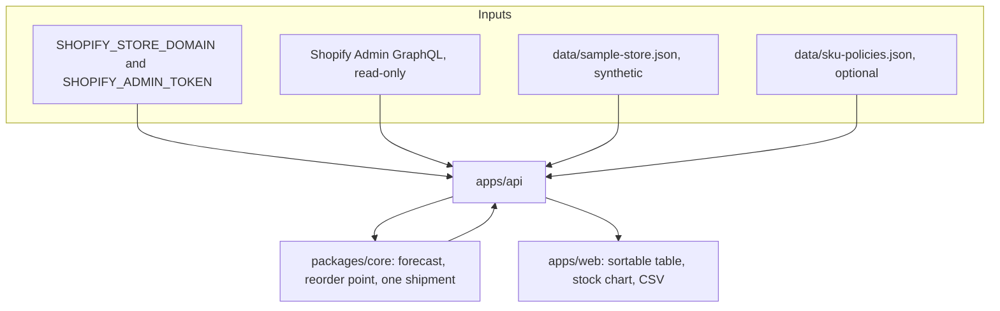
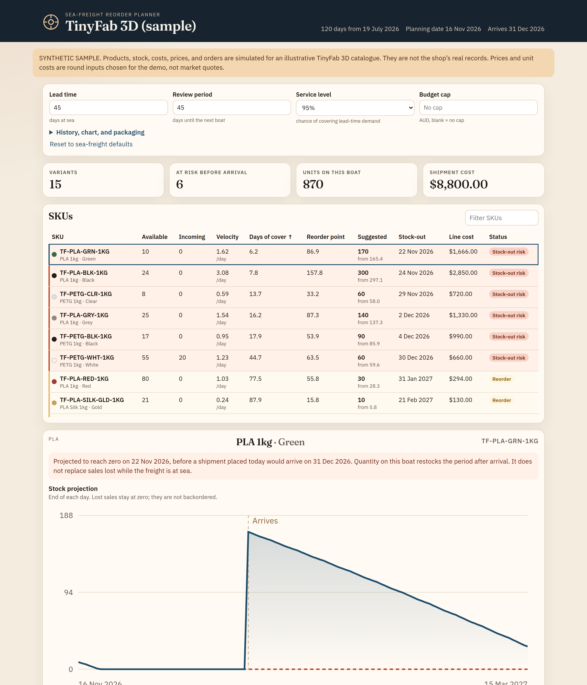
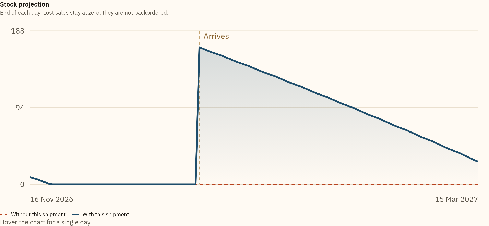
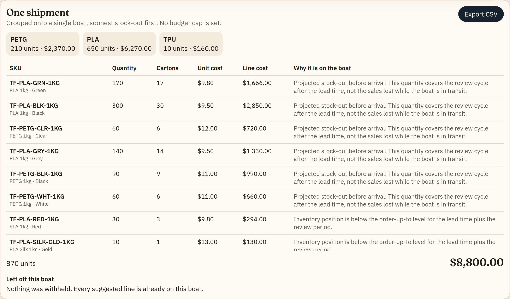

# Shopify Reorder Planner

Inventory and reorder planner for a Shopify store with long sea-freight lead times.

TinyFab 3D sells 3D-printing filament to Australian customers. Replacement stock is made in China and moves by sea. The planning figure for that lane is about one and a half months, 45 days by default. A reorder placed when the shelf already looks thin arrives after the shelf is empty. This planner turns products, inventory, and order history into one shipment: what to put on the next boat, how many, and which SKUs are projected to run out before that boat can arrive.

It does not place the order. It does not write to Shopify. With no credentials it runs on a bundled catalogue that is simulated and labelled as such. Nothing in that catalogue is TinyFab 3D’s real stock, cost, or sales.

## Run it

Requires Node.js 20 or newer.

```bash
npm install
npm run dev
```

Open http://localhost:5173. The API listens on port 8787 and the Vite dev server proxies `/api` to it. Leave `SHOPIFY_ADMIN_TOKEN` empty and the app uses the synthetic sample. The sample planning date is fixed at 16 November 2026 so the numbers do not drift with the wall clock.

```bash
npm test           # forecasting and reorder unit tests
npm run check      # format, lint, types, tests, and the web build
```

## Sample data

`data/sample-store.json` is synthetic. The file says so, and the API refuses to serve it if that label is missing. It is a filament catalogue (PLA, PETG, TPU, ABS, by colour) with 180 days of simulated orders. Base rates, weekday weights, trend, and the stock levels are generator inputs, stored under `generator` in the JSON. They are not measurements.

Prices and unit costs are round illustrative inputs, not market quotes. Regenerate the file with `npm run generate-sample` (seed 70916).

Per-SKU MOQ and carton size live on those sample variants. For a real shop, copy `data/sku-policies.example.json` to `data/sku-policies.json` (gitignored) and key it by SKU. Variants with no policy use the default MOQ and carton size in the planner settings, which start at 1 and 1 so the app does not invent a carton quantity.

## Formulas

History is daily unit sales per SKU in the shop’s timezone. Days with no orders inside the lookback are zero. Days before the feed starts are not filled with zeros. The planning date itself is excluded.

**Weekday index.** For each weekday, divide that weekday’s mean demand by the mean of the whole lookback. A weekday with no observations stays at 1. Divide the seven indexes by their mean so they average to 1.

**Deseasonalised demand.** Divide each day by its weekday index. If the index is essentially zero, use the overall mean for that day so the level is not dragged to zero.

**Moving average and trend.** The level is the moving average of the last W deseasonalised days. The trend is the least-squares slope of the whole lookback, in deseasonalised units per day per day. Fitting the slope on the whole lookback, rather than on the short window, stops one noisy month from being drawn as a straight line across a 45-day voyage. The screen also shows the raw trailing moving average, which is not the number used to order.

**Forecast.** The moving-average window ends the day before the planning date. Its centre sits `(W + 1) / 2` days before the planning date. For a future day `k` (0 is the planning date), `level = max(0, moving average + slope × ((W + 1) / 2 + k))`, then multiply by that day’s weekday index.

**Forward daily velocity.** The mean of the daily forecasts across the lead time. Days of cover are `available / forward daily velocity`. The value is left blank when velocity is zero.

**Residual σ.** Sample standard deviation (divisor n − 1) of actual minus fitted raw demand on the moving-average window.

**Safety stock.** `z × σ × √H`. `z` is the standard-normal quantile of the service level (95% → about 1.645). `H` is the lead time for the reorder point, and the lead time plus the review period for the order-up-to level. Daily errors are treated as independent with constant variance. The weekday pattern and the trend are treated as known. Lead time does not vary in this term.

**Reorder point.** Lead-time demand (the sum of the forecasts) plus safety stock over the lead time.

**Inventory position.** `available + incoming`. Shopify’s available figure is used as reported, including a negative value when a variant is oversold. Incoming has a quantity and no date, so it is added on the morning of the lead-time day.

**Order-up-to.** Forecast demand over the lead time plus the review period, plus safety stock over that same protection period. The raw quantity is `max(0, order-up-to − inventory position)`. A raw quantity of zero stays zero: the MOQ does not create an order by itself. Otherwise the quantity becomes `max(raw, MOQ)`, rounded up to a whole number of cartons.

**Stock-out date.** Walk available stock forward, subtracting the forecast, and add incoming at the start of the lead-time day before that day’s demand. The stock-out date is the first day demand is greater than the stock on hand. Stock is not allowed to go negative (lost sales, not a backorder). The search runs for at least 366 days even when the chart is shorter. A shipment placed today cannot refill demand that happens before it arrives, so a stock-out during the voyage stays a stock-out. The suggested quantity covers the review cycle after arrival.

**One shipment.** Lines with a suggested quantity are filled soonest stock-out first, then shortest days of cover. Under a budget cap, a line takes its full suggestion when the remaining money covers it, otherwise the largest whole number of cartons that still meets the MOQ. Unknown unit costs are listed and do not draw down the cap. Lines are also subtotalled by product type so the boat can be read as PLA, PETG, TPU, and so on.

## Architecture



`packages/core` is pure TypeScript. The API and the unit tests both call it. The browser only renders the plan the API returns.

Shopify is queried at Admin GraphQL `2026-10` (override with `SHOPIFY_API_VERSION`). The operations are `shop`, `products` with variant inventory quantities (`available`, `on_hand`, `committed`, `incoming`) and `unitCost`, and `orders` with line-item `currentQuantity`. Scopes are `read_products`, `read_inventory`, and `read_orders`. The client refuses to send a mutation. Order search starts two days before the lookback so a timezone ahead of UTC is not missing its first morning, and cancelled, voided, refunded, and pending orders are not counted.

## Screenshots

Taken in sample-data mode. The banner on each screen is the synthetic-data label.







## Connect a real store

1. In the Shopify admin, create a custom app and install it on the shop.
2. Grant only the Admin API scopes `read_products`, `read_inventory`, and `read_orders`.
3. Copy `.env.example` to `.env`. Set `SHOPIFY_STORE_DOMAIN` to the `*.myshopify.com` host and `SHOPIFY_ADMIN_TOKEN` to the Admin API access token.
4. Optional: set `SHOPIFY_ORDER_LOOKBACK_DAYS` (default 180) and `SHOPIFY_API_VERSION` (default `2026-10`).
5. Optional: add `data/sku-policies.json` for MOQ and carton size. Without it, SKUs use the defaults in the settings panel.
6. Restart `npm run dev`.

If the domain or the token is missing, or the domain is still the placeholder in `.env.example`, the app stays on the sample. If both are set and Shopify returns an error, the screen shows that error. It does not silently fall back to sample data.

`unitCost` is present only when the token is allowed to view product costs. Lines with no cost stay on the shipment and are marked unknown; they do not consume the budget cap.

A variant with no SKU is skipped. Duplicate SKUs are merged by summing inventory. Units sold against an unknown SKU are counted as ignored and left out of velocity. Inventory that is not tracked does not get a suggested quantity.

## Design decisions

- One TypeScript planner, tested on its own, so the screen and the tests cannot drift apart.
- Sea freight is a periodic review, not a continuous one. The reorder point is still lead-time demand plus safety stock. The quantity to buy is an order-up-to level over the lead time plus the review period, because the next boat is about that far away. Both default to 45 days. Set the review period to 0 to order only back to the reorder point.
- Safety stock uses the residual around the weekday-and-trend fit, not the raw standard deviation, so a regular Saturday bump is not treated as surprise noise.
- Weekday indexes are estimated from the raw lookback. A very steep trend can leak a little into them. For a mild trend over a few months that bias is small, and the slope test in the unit tests is kept on the least-squares function itself.
- The budget fill is greedy by stock-out date. It is not a cost optimiser. A cheaper SKU does not jump a SKU that runs out sooner.
- Sample mode exists so the repository demonstrates the planner with no secrets. Live mode is read-only on purpose. Writing a draft purchase order back to Shopify would need extra scopes and is listed under next steps.
- The sample planning date is fixed. A live shop uses today’s date in the shop timezone from `shop.ianaTimezone`.

## Tests and CI

Unit tests cover the normal quantile, least squares, weekday forecast, safety stock, reorder point, order-up-to quantity, MOQ and carton rounding, the stock projection (including incoming that lands on the lead-time morning), budget allocation, and the synthetic catalogue’s mix of statuses. The Shopify mapper and the paginating client are tested with a fake `fetch`. No test calls a real shop.

GitHub Actions (`.github/workflows/ci.yml`) runs format, lint, typecheck, tests, and the web build on Node 22.

## Next steps

- A lead-time variance term, once a lane has a real spread of arrival dates rather than a single planning figure.
- Arrival dates for stock already on the water. The feed only has an incoming quantity.
- MOQ and carton size as Shopify metafields, instead of `data/sku-policies.json`.
- Bulk operations for a catalogue or an order history this paginated client would refuse to truncate silently.
- A backtest: hold out the last month and score the forecast. That number is not claimed here.
- With write scopes, create the suggested shipment as a draft purchase order. This build does not do that.

## Author

Gary Chen ([@Gary709](https://github.com/Gary709))
